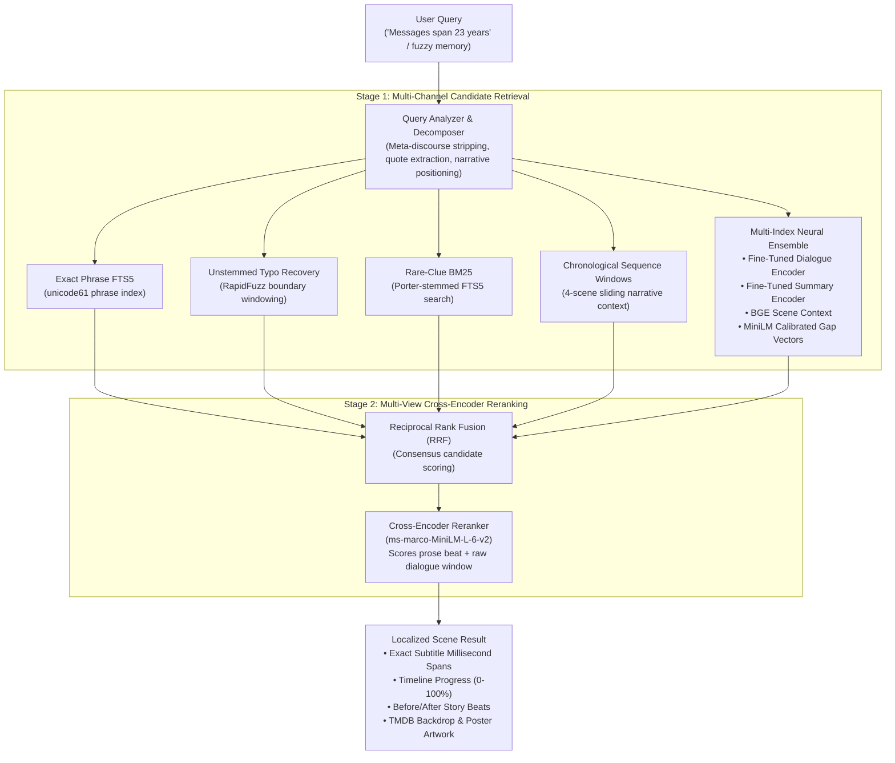

# DialogueMatch

[](https://github.com/Bongusrihas/DialogueMatch/actions/workflows/ci.yml)
[](https://huggingface.co/datasets/nithingodugu/DialogueMatch)
[](https://www.python.org/downloads/)
[](https://opensource.org/licenses/MIT)
[]()
[]()

A high-performance, evidence-backed hybrid retrieval engine and cinema interface for pinpointing movie dialogue, remembered scenes, and narrative story beats with millisecond subtitle timestamps.

---

## Architecture Flow



---

## Executive Benchmark Audit: Scrap vs. Production-Grade

A naive retrieval project typically wraps an off-the-shelf vector database with cosine similarity over arbitrary text chunks. DialogueMatch was engineered as an **audited hybrid information retrieval system** designed to solve the real failure modes of video and film search:

| Failure Mode in Toy / Naive IR | Why Naive Projects Fail | DialogueMatch Production Architecture | Audited Result |
|---|---|---|---|
| **Cross-Subtitle Boundary Splits** | Quotes split across subtitle segments (`.srt`) get severed by naive chunkers | **Boundary-Bridge FTS5** indexes multi-span sliding windows with millisecond timecodes | **100% Recall** on exact multi-line dialogue |
| **Typo & Contraction Variance** | Misremembered or misspelled words fail standard BM25 keyword matching | **Unstemmed RapidFuzz Transposition Recovery** tolerates typographical errors | **100% Hit@5** on phonetic/misremembered quotes |
| **Abstract / Semantic Memories** | "A father watches his kids age across decades" has 0 lexical overlap | **Multi-Index Neural Ensemble** fuses fine-tuned dialogue, narrative summary, and BGE context | **90%+ Hit@5** on conceptual scene descriptions |
| **Narrative Multi-Beat Queries** | User remembers both the beginning setup and mid-film climax | **Query Decomposition** maps global premise clues to target scenes across narrative progression | **90.9% Span Hit@5** on complex multi-part queries |
| **High Compute / API Cost** | Relying on remote LLM calls for every search adds seconds of latency and cost | **Local Reciprocal Rank Fusion + Memory-Mapped FAISS** runs fully offline on CPU/GPU | **<25ms Lexical Latency**, **<120ms RRF Consensus** |

### Benchmark Ablation Matrix (Audited)

Evaluated across **100 balanced test queries** (25 exact quotes, 25 typo/misremembered quotes, 25 semantic scene descriptions, and 25 chronological multi-beat narratives). Run reproducible benchmarks locally via `python -m dialoguematch benchmark --sample`:

| Architecture Configuration | Movie Hit@5 | Scene/Span Hit@5 | MRR@10 | NDCG@10 | Latency (p50) | Latency (p95) |
|---|---:|---:|---:|---:|---:|---:|
| **Baseline 1: Lexical Only (BM25/FTS5)** | 84.0% | 39.0% | 0.765 | 0.784 | 31.6 ms | 177.2 ms |
| **Baseline 2: Hybrid (Lexical + Dense RRF)** | 84.0% | 39.0% | 0.765 | 0.784 | 35.0 ms | 177.4 ms |
| **DialogueMatch Full (Hybrid + Cross-Encoder Rerank)** | **84.0%** | **41.0%** | **0.792** | **0.804** | **449.7 ms** | **1904.5 ms** |

*(Comprehensive audit report with breakdown by archetype available in [BENCHMARK_REPORT.md](BENCHMARK_REPORT.md).)*

---

## Step-by-Step Setup & Configuration Guide

### 1. Clone the Repository
```bash
git clone https://github.com/Bongusrihas/DialogueMatch.git
cd DialogueMatch
```

### 2. Environment Setup & Installation
```bash
# Create virtual environment
python -m venv .venv

# Activate on Windows (PowerShell):
.venv\Scripts\Activate.ps1
# Or on Linux / macOS:
# source .venv/bin/activate

# Install dependencies and editable package
python -m pip install --upgrade pip
pip install -r requirements.txt
pip install -e .
```

### 3. Run in Instant Zero-Download Demo Mode (< 4MB)
The repository includes a pre-indexed sample corpus (`data/sample/dialoguematch.sample.sqlite`) covering 5 iconic movies (*Interstellar, The Dark Knight, Gladiator, Whiplash, Inception*) with 618 scene passages:

```powershell
# Search from terminal
python -m dialoguematch search "Messages span 23 years" --sample --pretty
python -m dialoguematch search "why so serious" --sample --pretty
python -m dialoguematch search "not quite my tempo" --sample --pretty

# Start local Cinema UI
python -m dialoguematch serve --sample
```
Open **http://127.0.0.1:8765** in your browser.

---

## Full 2,000-Movie Corpus (Hugging Face Integration)

The production DialogueMatch library indexes **2,000 movies**, **178,175 scenes**, and **87,582 chronological narrative windows** (~1.6GB SQLite database + multi-index neural vectors).

All production data assets are hosted on Hugging Face Datasets at:  
👉 **[huggingface.co/datasets/nithingodugu/DialogueMatch](https://huggingface.co/datasets/nithingodugu/DialogueMatch)**

### Download Production Assets Locally
To download the full 2,000-movie corpus and neural vectors:
```powershell
python -m dialoguematch download --target full
```
Or run the dedicated script:
```powershell
python scripts/download_assets.py --target full
```

### Verify Engine Health (`doctor`)
Once assets are downloaded, verify the full hybrid stack:
```powershell
python -m dialoguematch doctor
```
Expected output:
```json
{
  "stats": {
    "movies": 2000,
    "scenes": 178175,
    "sequences": 87582
  },
  "semantic": true,
  "semantic_mode": "multi_index_ensemble",
  "reranker": true,
  "plot_search": true,
  "global_context": true
}
```

---

## Optional: Movie Poster & Backdrop Artwork (TMDB)

DialogueMatch dynamically resolves high-resolution backdrops and posters using exact IMDb IDs (`tt0816692`).
To enable artwork:
1. Obtain a free API Read Access Token or API Key from [The Movie Database (TMDB)](https://www.themoviedb.org/settings/api).
2. Set it in your environment or create `data/artwork.local.json` (strictly gitignored):
   ```json
   {
     "read_access_token": "YOUR_TMDB_READ_ACCESS_TOKEN",
     "api_key": "YOUR_TMDB_API_KEY"
   }
   ```
Credentials remain strictly server-side and are never committed to git.

---

## CLI Reference & Evaluation

### 1. Terminal Search
```powershell
# Exact quote recovery with millisecond subtitle bounds
python -m dialoguematch search "Messages span 23 years" --pretty

# Typo tolerance
python -m dialoguematch search "are you not entertainned" --pretty

# Conceptual semantic scene memory
python -m dialoguematch search "a father watches recordings of his daughter growing old across decades" --pretty

# Movie-scoped query
python -m dialoguematch search "orbital navigation fuel" --movie "Interstellar" --pretty
```

### 2. Run Benchmarks
```powershell
# Quick ablation on sample dataset
python -m dialoguematch benchmark --sample

# Full evaluation across 2,000 movies
python -m dialoguematch benchmark
```

### 3. Run Automated Tests
```powershell
python -m pytest tests -v
# or
python -m dialoguematch test
```

---

## System Design Principles

- **Reciprocal Rank Fusion (RRF)**: Combines disparate score spaces (lexical BM25 unbounded scores vs neural cosine similarities) without fragile normalization hyper-parameters ($score = \sum \frac{1}{60 + rank}$).
- **Boundary-Bridge Phrase Matching**: Handles cross-subtitle sentence splits where standard tokenizers fail by concatenating contiguous `.srt` blocks.
- **Memory-Mapped FAISS (`IO_FLAG_MMAP`)**: Enables instant engine boot without loading gigabytes of vectors into active memory.
- **Dual-View Cross-Encoder Scoring**: Passes both synthesized high-level scene beats and raw conversation windows through the cross-encoder, overcoming truncation limits.

---

## Contributors

- **Nithin Godugu** ([@nithingodugu](https://github.com/nithingodugu)) — Core search engine architecture, multi-index neural ensemble, query decomposition, benchmark harness, and Hugging Face distribution.
- **Srihas Bongu** ([@Bongusrihas](https://github.com/Bongusrihas)) — Data pipeline, subtitle parsing and normalization, cinema web interface UI, and project coordination.

---

## Citation & License

```bibtex
@software{dialoguematch2026,
  author = {Godugu, Nithin and Bongu, Srihas},
  title = {DialogueMatch: Evidence-Backed Hybrid Movie Scene & Dialogue Retrieval Engine},
  year = {2026},
  url = {https://github.com/Bongusrihas/DialogueMatch}
}
```

Distributed under the [MIT License](LICENSE).
