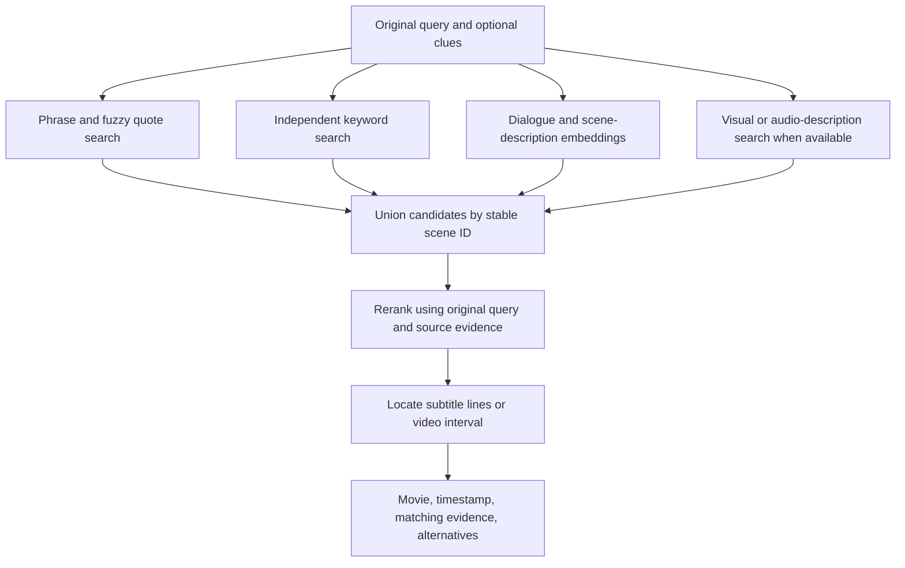

DialogueMatch: evidence and a practical route to reliable scene search

Research date: 29 October 2026. Intended product, confirmed by the user: identify a movie and scene from a remembered description or paraphrased dialogue, and locate exact dialogue with timestamps.

The project is worth continuing, but its next iteration should prioritize corpus integrity, scene-level evaluation, and separate quote/description retrieval paths. Changing the embedding model alone will not resolve absent movies, incomplete subtitles, contradictory labels, or actions that are never described in the input.

This report combines inspection of local Python and notebooks, an audit of 165,302 chunks covering 1,926 movie IDs, 15 illustrative lexical searches, and primary research/documentation. The diagnostic searches use SQLite FTS5 over dialogue and summary. They are not measurements of the existing neural pipeline, and the selected examples are not a representative held-out benchmark. No production database, model service, or paid API was used.

**1. What is actually going wrong**

| Finding | Evidence from this workspace | Consequence |
|---|---|---|
| Some expected movies are missing | The 310-row evaluation names 88 movie IDs; 28 rows concern 8 IDs absent from `chunks-context-top2k.json` | Those queries cannot retrieve their expected movie from this snapshot |
| Some subtitle records need completeness checks | Fellowship (`tt0120737`) has 20 chunks, ending at 2,392 seconds, and begins with the group entering an elf-controlled forest; The Dark Knight's last chunk ends at 4,814 seconds | Suspect partial files, split releases, timestamp resets, or ingestion loss; establish which before trusting timestamps |
| Dialogue benchmark labels conflict | `dialogue_only_eval_300.csv` has 300 rows but 40 unique normalized queries; all 40 map to multiple movie IDs | A deterministic query-only system has a maximum single-label top-1 accuracy of 40/300 = 13.33% on these rows, even with perfect knowledge |
| Movie success is being confused with scene success | `evaluate_mrr` in `cross_encoding_fixed.ipynb` compares only the movie portion of `scene_id` | The wrong scene from the right film counts as correct |
| BM25 cannot rescue missed candidates in V3 | `V3/train.ipynb`, cell 13, evaluates BM25 only on the 200 candidates already returned by the dense index | This is reranking a dense pool, not independent lexical candidate retrieval |
| Chunk overlap disappears during export | `movie_chunker.py:54` removes `overlap_text`; the previous text is not inserted into `text` | The exported representation does not retain the computed overlap |
| Short-chunk merging defeats boundaries | The merge at `movie_chunker.py:478` does not recheck time gaps or the hard duration limit | A synthetic input with intervals 0–30 and 200–205 seconds becomes one 0–205-second chunk |
| Potentially useful cues are removed | Cleaning removes bracketed cues and speaker labels; `COOPER: [crying] ...` loses both | Preserve these in separate fields rather than making cleaned text the only record |
| A “fixed” reranker loses dialogue | `build_rerank_text` takes only `text[:400]` characters in `cross_encoding_fixed.ipynb` | A quote later in the chunk can disappear before scoring |
| Context can displace the actual passage | V3 budgets 512 words, then uses a model limited to 512 tokens; it places neighboring summaries before the current dialogue | Tokenizer truncation may remove relevant current text; words and tokens are different budgets |
| The ColBERT experiment is not ColBERT | `colbert-demo.ipynb` embeds split sentences with MiniLM and returns the first query sentence's search results | This experiment does not evaluate contextual token embeddings and MaxSim late interaction |

The exported corpus contains 19,667 chunks longer than 100 seconds and 14,628 with more than 145 words. These are observations against the current chunker's stated limits, not proof that every export was built using the same code version. Large passages can be useful as parent context, but need explicit representation rather than accidental merging.

Some other risks need validation rather than a definitive bug claim: notebooks use multiple embedding models and index files without a verified shared manifest; V3 loads `chunk_ids` but resolves retrieved positions directly into `chunks`. That is correct only if their ordering is identical. Check model revision, dimensions, normalization, text-construction version, corpus hash, and ordered ID mapping before any model comparison.

The 310-row evaluation has no duplicate-query conflict in this audit, but it still lacks scene spans. The 300-row dataset could be repurposed for broad thematic search with multiple relevant labels; it cannot be treated as an unambiguous movie-identification test.

**2. Searches performed on your data**

The baseline independently indexed all dialogue and summary fields, used OR over query terms, and ranked with SQLite's BM25. Phrase checks additionally searched the dialogue field as an exact normalized phrase. “Movie rank” below is the position of the first chunk from that film, not proof of scene correctness.

| Search | Observed outcome | What it establishes |
|---|---|---|
| `Messages span 23 years` | Correct Interstellar chunk `tt0816692_77` at rank 1; phrase search also rank 1 | The distinctive dialogue is present and searchable |
| `23 years messages` | Same chunk at rank 1 | Extracting a useful clue can recover a candidate |
| `a man cries after watching 23 years of missing videos` | That chunk absent from top 200 | A longer natural description can overwhelm a naive lexical query |
| `I am going to make this pencil disappear` | Correct Dark Knight chunk `tt0468569_23` at rank 1, including phrase search | The quote path can work without a generative model |
| `magic trick making a pencil disappear` | `tt0468569_23` at rank 1 | Some scene descriptions also have strong dialogue anchors |
| `joker pencil trick in the mob meeting` | Movie at rank 1, but top chunk is `_6`, not the explicitly located pencil passage `_23` | Movie-level metrics can hide a localization error |
| `joker walking away from hospital explosion in a nurse outfit` | First Dark Knight chunk at rank 33 | A visual description is a harder task; scene correctness remains unverified |
| `hallway fight with zero gravity` | Inception absent from top 200 | Visual scene descriptions need more than this baseline |
| `spinning top ending does it fall` | Inception absent from top 200 | Same limitation; not evidence that every retrieval model must fail |
| `crying while watching decades of video messages from kids` | Interstellar movie rank 8 | Wording and representation materially affect candidate ranking |
| `What is the most resilient parasite` | Inception movie rank 59; full normalized phrase not found in its chunk text | Verify subtitle wording, missing passages, and language/version before blaming embeddings |
| `Are you not entertained` | No Gladiator chunks exist in this snapshot | A corpus-coverage failure |
| `You shall not pass` | Phrase not found in the 20 Fellowship chunks | Movie presence alone does not establish dialogue coverage |

The full results also include the giant-wave description and a quote taken from the local Inception text. Reproduce with `python research/audit_retrieval.py --lexical`; inspect [audit results](C:/Users/nithi/Desktop/DialogueMatch/research/audit_results.json).

The Interstellar example spans neighboring chunks. Chunk `_75` contains the elapsed-years information, `_76` introduces stored messages, `_77` begins playback, and later chunks continue the family updates. `_77` runs from 4,675.451 to 4,743.528 seconds in this subtitle file. These are subtitle-relative times, not verified timestamps for every release of the movie. “Crying” is not explicitly stated in that chunk's dialogue. A generated summary may infer it, but cannot serve as independent visual evidence.

**3. Treat the product as two retrieval tasks**

Exact or near-exact quotes require preserving wording, finding phrase matches, and locating the matched subtitle lines. Remembered descriptions require handling paraphrases, uncertainty, actions, relationships, and sometimes absent visual evidence. Use one search box with two candidate paths; uncertain routing should search both.

Remembered-movie search is an established research problem called tip-of-the-tongue retrieval. The research describes uncertain and imperfect memories, and the need for specialized representations. This makes clarification and multiple plausible candidates legitimate product behavior. It does not establish scene timestamp accuracy. [Movie-identification study](https://www.microsoft.com/en-us/research/publication/tip-of-the-tongue-known-item-retrieval-a-case-study-in-movie-identification/), [TREC ToT track](https://trec-tot.github.io/).

**4. Approaches worth implementing, in order**

| Approach | Best fit | Effort and limitation | Recommendation |
|---|---|---|---|
| Quote-first phrase, n-gram, and fuzzy matching | Exact dialogue, small mistakes, wording variants | Low; cannot recover an absent transcript | First deliverable |
| Independent BM25 + dense retrieval + reranking | Paraphrases and scenes with textual clues | Moderate; still limited by corpus evidence | Core retrieval baseline |
| Small passages linked to larger scene context | Clues distributed across adjacent chunks | Moderate; sloppy context can mix unrelated events | Build alongside the baseline |
| Verified event descriptions and query paraphrases | Human descriptions unlike dialogue wording | Moderate annotation/generation cost; unsupported details pollute search | Add a separately weighted retrieval field |
| Audio descriptions or video-derived descriptions | Silent actions, costume, objects, reactions | Higher data and preprocessing cost | Required path toward broad visual-scene coverage |
| Multimodal clip embeddings and reranking | Text-to-video candidate search | Higher compute; short visual evidence can be missed by sparse sampling | Pilot on a small corpus |
| Genuine ColBERT/BGE-M3 multi-vector retrieval | Fine-grained textual relevance | More storage and operational complexity | Compare after the baseline is valid |
| Domain fine-tuning with hard negatives | Persistent confusion between similar scenes | Needs reliable labels; can learn annotation mistakes | Later, after error analysis |

For quote retrieval, store the original subtitle text and original line timestamps. Maintain a separate normalized form for case, punctuation, whitespace, apostrophes, and contractions. Search across adjacent subtitle lines because a quote may cross a line boundary. Use phrase or proximity matches first, then fuzzy candidates for typos and remembered variants. Preserve multiple matches for generic phrases. Return the timestamp of the matched line span, with an optional larger playback window.

For description retrieval, independently retrieve initial candidates from dialogue BM25, dialogue vectors, and scene-description vectors. Add quote matches and visual candidates when available. As an initial tuning configuration, retrieve up to 100 per active channel, fuse by stable scene ID, and rerank roughly 50–100. These are starting parameters, not measured optimal settings.

Reciprocal rank fusion is a useful initial method because lexical and vector scores have different scales. It combines ranks across independent result lists. Start with equal weights and a rank constant such as 60, then tune on development data. Do not interpret its output as a probability. [OpenSearch RRF documentation](https://docs.opensearch.org/latest/vector-search/ai-search/hybrid-search/rrf/).

Retain the original user query. In addition, extract distinctive clues such as “23 years” and “recorded messages” into an extra retrieval query. Do not replace the original with invented relationships or emotions. Uncertain clues should boost candidates rather than automatically exclude alternatives. Your existing instruction to “add missing context” risks making an incorrect guess influence every downstream stage.

Reranking should inspect complete relevant evidence within an actual token budget. A reranker cannot recover a scene missing from its candidate set; log candidate recall separately from final accuracy. General retrieve-and-rerank pipelines are established practice, but a web-passage reranker must still be evaluated on movie descriptions. [Sentence Transformers retrieval documentation](https://www.sbert.net/examples/sentence_transformer/applications/retrieve_rerank/README.html), [MS MARCO training context](https://www.sbert.net/examples/sentence_transformer/training/ms_marco/README.html).

**5. Improve what each scene record contains**

Use an explicit hierarchy: movie/version → scene or context window → subtitle line. Keep line text immutable and derive retrieval fields from it. Suggested fields include stable IDs, source subtitle file/hash, language, release/version, line start/end, raw dialogue, normalized dialogue, speaker if known, sound/action cues, parent scene ID, neighboring IDs, grounded event description, entities, and evidence references.

Separate observations from interpretations. Each event-description claim should point to a subtitle span, audio-description span, or video interval. Allow “unknown” for actor, relationship, location, and emotion. Your 20-word summaries and thematic keywords often compress away discriminating detail. A concise factual event record can be longer when necessary; the correct budget is an empirical choice.

Use small units for locating exact words and larger parent context for interpreting them. Test subtitle-line windows and context windows rather than assuming a five-second silence marks a narrative scene. Prevent short-chunk merging across hard boundaries, or preserve the merged passage only as a parent. Protect current evidence when fitting context into a tokenizer budget.

Contextual retrieval research supports adding chunk-specific context and lexical retrieval, but it does not prove that generated movie summaries are accurate or that improvements transfer to DialogueMatch. Keep the original dialogue indexed independently. [Contextual retrieval study](https://www.anthropic.com/research/contextual-retrieval).

For an event such as “a father watches years of recorded family messages,” create different searchable views only where supported: the actual words, the event, and ordinary-language paraphrases. Query generation already exists in this project; its value should be tested by indexing that field separately. Do not use generated queries from the same scenes as both training data and your final test set.

**6. How to support visual memories**

If only subtitles are available, the achievable promise is strongest for dialogue and dialogue-supported scenes. A full-film story reconstruction generated from subtitles can suggest candidates, but it cannot establish a silent event or exact time. Broad visual-memory support requires adding evidence.

Audio descriptions are especially relevant: they narrate visible actions for viewers. MAD grounds natural-language descriptions in long movies, making it a closer research reference than a general document-search benchmark. AutoAD studies generating descriptions using video and context. Use these to guide representation and evaluation; they do not supply complete searchable material for every desired film. [MAD](https://arxiv.org/abs/2112.00431), [AutoAD](https://arxiv.org/abs/2303.16899).

When video is available, sample clips and generate observable descriptions or multimodal embeddings offline. Preserve their exact source intervals. Retrieve broadly, then inspect neighboring frames/clips to refine the interval. Shot-change detection can help form units, but a shot boundary is not necessarily a narrative scene boundary. [PySceneDetect](https://www.scenedetect.com/).

Qwen3-VL-Embedding and Qwen3-VL-Reranker provide a current candidate stack supporting text, images, and video, including 2B and 8B variants. Pilot the smaller variant with controlled clip sampling before committing to a large index. Its benchmark results do not establish accuracy on your films, and sampling may miss brief actions. [Official implementation](https://github.com/QwenLM/Qwen3-VL-Embedding), [technical report](https://arxiv.org/abs/2601.04720).

Condensed Movies studies retrieval with character, speech, visual, and contextual information. QVHighlights provides a model for evaluating localized intervals, but its vlog/news domain differs from movies. These support a multimodal and temporal evaluation design, not a ready-made accuracy guarantee. [Condensed Movies](https://arxiv.org/abs/2005.04208), [QVHighlights](https://arxiv.org/abs/2107.09609).

**7. Model selection and alternatives to defer**

Keep your existing BGE model as a controlled baseline after validating its indexes. For a second text baseline, BGE-M3 supports dense, sparse, and multi-vector retrieval; those modes must actually be enabled through an appropriate implementation. Plain sentence embeddings alone do not exercise all three. Qwen3 embedding/reranking is another model family to compare on the same fixed corpus and queries. Choose using scene-level quality, latency, memory, and throughput rather than a general leaderboard. [BGE-M3 model card](https://huggingface.co/BAAI/bge-m3), [Qwen3 retrieval report](https://arxiv.org/abs/2506.05176).

Actual ColBERT uses contextual token representations and late interaction; sentence splitting with MiniLM does not implement it. Test it if single-vector retrieval still loses important clues after corpus and evaluation repairs. [ColBERTv2](https://arxiv.org/abs/2112.01488).

Do not start by rebuilding everything as GraphRAG. Explicit character/event relations may eventually help queries about multiple events, but a graph of inferred subtitle facts can preserve the same errors at higher complexity. Likewise, adding more emotion labels, swapping vector databases, or prompting an LLM to guess a timestamp does not repair missing evidence.

Fine-tune only after collecting verified positives and difficult negatives: another crying scene, another video-message scene, a nearby but wrong moment from the same film. Split development/test by movies where possible, and keep paraphrases of the same scene in the same split. Avoid treating a genuinely relevant neighboring span as a negative.

**8. The evaluation that should decide what ships**

Create an initial manually verified set of about 200 queries, expanding later: exact quotes, noisy quotes, dialogue paraphrases, event descriptions, visual-only descriptions, and ambiguous or unavailable requests. Have people write memory queries without copying indexed descriptions. Label movie ID, source version, relevant subtitle lines or time spans, acceptable alternate spans, query type, and whether the corpus actually contains the needed evidence.

Measure these independently:

- Corpus coverage: does the correct movie/version and evidence exist?
- Candidate scene Recall@100: did retrieval surface at least one correct span?
- Scene Hit@1/5 and MRR@10: are the right moments ranked early?
- Temporal overlap or start/end error: is the returned interval useful? For visual scenes, report temporal IoU thresholds such as 0.3 and 0.5; for quotes, use line-span accuracy and an explicitly chosen timestamp tolerance.
- Accuracy of no-match/clarification decisions: does the system avoid confidently selecting an unrelated scene?
- Median and p95 latency, peak memory, and preprocessing time.

Evaluate available-corpus retrieval separately from all-request success. Excluding unavailable films from a retrieval score is useful, but their failures must remain visible in the end-to-end product score. For vague queries with many valid matches, use multiple relevant labels or evaluate clarification; do not force an arbitrary single correct film.

Run ablations in this order: phrase/BM25 → dense alone → independent hybrid → hybrid plus reranker → neighboring context → grounded descriptions/query paraphrases → visual evidence → domain fine-tuning. Use the same fixed test set and record per-query changes. Increasing MRR's cutoff from 10 to 20 changes the metric; it is not an accuracy fix.

Suggested pilot gates, explicitly targets rather than achieved results: at least 95% Hit@1 for covered, unambiguous exact quotes; at least 90% candidate Recall@100 and 80% scene Hit@5 for covered text-supported descriptions. Agree on visual-query targets only after a pilot establishes feasibility. Report denominators and uncertainty, especially with small query groups.

**9. A staged implementation plan**

Stage A: repair the evidence. Audit every movie against an expected subtitle/version manifest. Detect absent titles, multipart subtitles, implausible timestamp ranges, empty sections, mismatched language, duplicate content, and inconsistent IDs. Recover complete sources where possible; label the remainder partial. Preserve line-level timestamps and cues. Build the verified evaluation before tuning.

Stage B: deliver quote lookup. Implement normalized phrase/proximity search plus fuzzy fallback and line-span timestamps. Use an explicit no-match response when the source lacks the quote. This is the smallest valuable end-to-end result for the pitched product.

Stage C: deliver remembered-description search. Build independent lexical and dense candidates, stable-ID fusion, context-aware reranking, and evidence excerpts. Preserve multiple plausible results and ask one discriminating follow-up when the query is underdetermined. Use movie-level search only as an additional candidate source or soft prior; a mistaken movie shortlist must not eliminate global scene candidates.

Stage D: test visual coverage on roughly 20–50 movies with complete accessible material. Compare audio descriptions, grounded clip captions, and multimodal retrieval. Expand only if the added channel improves held-out visual queries enough to justify preprocessing and serving costs.

Stage E: fine-tune or adopt multi-vector retrieval only for the remaining measured failure types. No fixed delivery date or cost estimate is justified without knowing source availability, hardware, and team capacity.

For a sustainable revised pitch: “Search an indexed movie library using a remembered quote or scene description, then inspect timestamped evidence and likely matches.” State visual coverage according to the sources actually indexed. A narrower launch can support exact quotes across a larger verified library and rich scene descriptions across a smaller annotated library, while keeping both modes in the same interface.

The immediate implementation order is corpus coverage → evaluation repair → quote lookup → genuine hybrid scene retrieval → grounded visual enrichment. The strongest differentiator is likely the quality of the scene evidence and localization, not the number of embedding models tried.

Audit artifacts: [script](C:/Users/nithi/Desktop/DialogueMatch/research/audit_retrieval.py), [results](C:/Users/nithi/Desktop/DialogueMatch/research/audit_results.json). Application code and existing indexes were not modified. Live index consistency and end-to-end neural accuracy remain unmeasured in this investigation.
